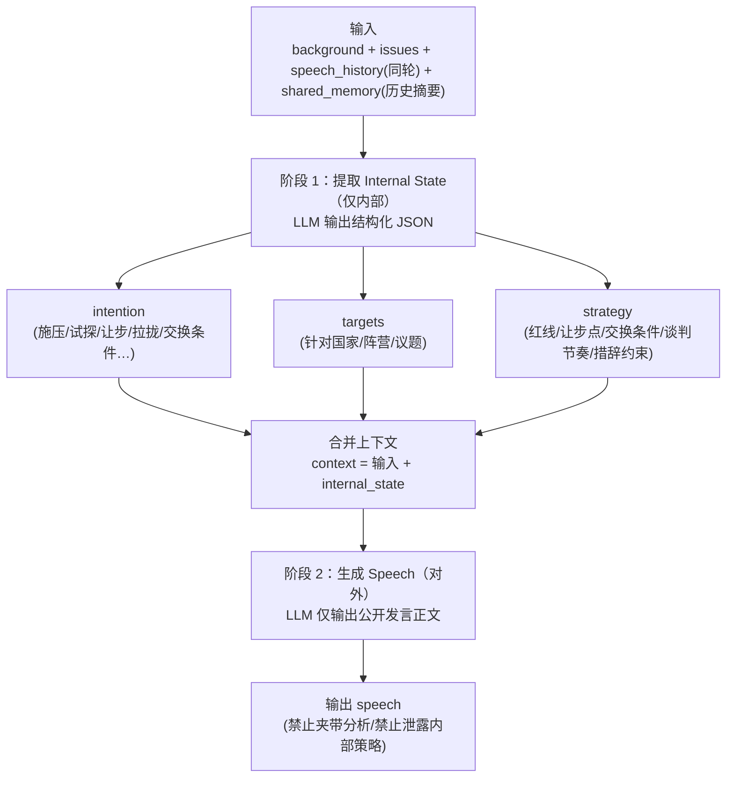

## 外交官模块（Diplomat Agents）

本模块负责 **A/B/C/D 外交官 agent 在每一轮生成公开发言（speech）**。

---

### 接收什么输入（HTTP 请求）

#### Endpoint

- **POST** `/api/v1/scenarios/{scenario_id}/agents/{agent_id}/speeches`
- 可选 Header：`X-Debug-Prompts: 1`（开启后端返回 prompt/debug 信息）

#### Request Body（JSON）

请求体为 JSON，建议结构如下（字段名与含义保持稳定）：

```json
{
  "agent_id": "A",
  "round": 2,
  "background": {
    "scenario_id": "demo-001",
    "world_background": "string",
    "countries": {
      "A": { "profile": "string" },
      "B": { "profile": "string" },
      "C": { "profile": "string" },
      "D": { "profile": "string" }
    }
  },
  "issues": {
    "issues": [
      { "issue_id": "i-1", "title": "string", "description": "string" }
    ]
  },
  "speech_history": [
    { "round": 2, "speaker": "B", "content": "string", "timestamp": "string" }
  ],
  "shared_memory": [
    {
      "round": 1,
      "summary": "string",
      "signals": {
        "alliances": ["A-B"],
        "conflicts": ["A-C"],
        "concessions": ["B"],
        "escalation_risk": "low"
      }
    }
  ]
}
```

说明：

- `speech_history` 用于提供**同轮内**已发生的发言上下文（避免跨轮重复注入；跨轮信息由 `shared_memory` 提供，避免上下文过长）。

---

### 负责什么输出（HTTP 响应 + 副作用）

#### Response Body（JSON）

- 正常返回：`AgentSpeechGenerateResponse`
  - `agent_id`: string
  - `round`: number
  - `speech`: string
  - `debug`（可选，仅当 `X-Debug-Prompts: 1`）：`{system,user,model,temperature}`

示例：

```json
{
  "agent_id": "A",
  "round": 2,
  "speech": "string",
  "debug": {
    "system": "string",
    "user": "string",
    "model": "deepseek/deepseek-v3.2",
    "temperature": 0.7
  }
}
```

# 

---

### 你接下来要做什么（TODO）

- **prompt 设计**：优化`prompt.json`中的prompt
- **两阶段生成**：先从当前输入里使用LLM抽取结构化的 *intention / strategy*（内部态度与策略，不对外），再基于「上下文 + intention/strategy」生成最终 `speech`
  - **阶段 1：提取（Internal State）**：输出结构化 JSON（建议只在服务内部使用/用于单测）
    - `intention`: 本轮想达成什么（施压/试探/让步/拉拢/交换条件等）
    - `targets`: 主要针对谁（国家/阵营/议题）
    - `strategy`: 具体策略（红线、可让步点、交换条件、谈判节奏、措辞风格约束）
  - **阶段 2：生成（Speech）**：输入为「背景 + 议题 + 本轮 speech_history + shared_memory + intention/strategy」，输出只包含公开发言正文
- **输出格式约束**：保证只输出公开发言正文（禁止夹带分析、禁止泄露内部策略）

#### 两阶段生成子流程图（Mermaid）



---
