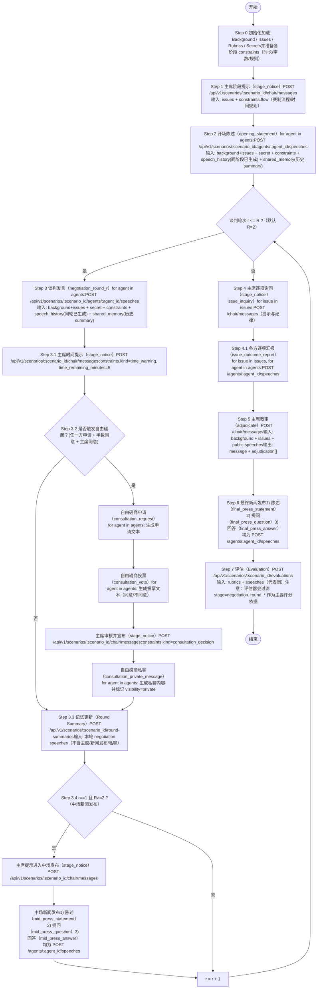

> 本文档描述一个用于外交官谈判与决策能力训练的多智能体仿真系统整体技术架构与运行 pipeline。
> 
> 
> 系统以**多轮外交会议模拟**为核心，通过多个外交官 AI、以及评估 AI 的协同工作，实现**无标准答案场景下的能力评估与反馈**。
> 

仓库：[Zhang-Dongfang/Diplomat](https://github.com/Zhang-Dongfang/Diplomat)

---

## 1. 系统架构

系统由四类核心模块构成：

1. 前端
2. 外交官智能体
3. 记忆与摘要模块
4. 评估智能体

---

## 2. 核心模块

### 2.1 场景初始化

### 输入内容

- **Background**
    - 世界观设定
    - 各国国情、历史、经济、能源结构等
- **Issues**
    - 本次会议的公开讨论议题（如边界问题、能源合作、灾后重建等）

### 特性

- 全局只读
- 所有智能体共享
- 不随轮次变化

---

### 2.2 外交官智能体（A/B/C/D）

每个外交官智能体代表一个国家或政治实体。

### 每轮输入

- Background + Issues
- 历史轮次发言记录
- 历史摘要记忆

### 内部流程

1. 生成本轮 **内部态度与策略**（不对外可见）
    - 对谁说？
    - 目标是什么？
    - 是施压 / 试探 / 让步 / 拉拢？
2. 基于态度和策略策略生成 **Speech**

### 输出

- `speech`：本轮公开发言文本

---

### 2.3 记忆与摘要模块

### 触发时机

- 每一轮所有外交官发言完成后

### 输入

- 本轮 A/B/C/D 的全部 speech

### 输出：共享记忆

摘要提炼：

- 各国核心立场变化
- 明示或暗示的让步 / 强硬态度
- 潜在联盟、对立关系
- 是否出现冲突升级或合作信号

### 用途

- 作为 **下一轮所有外交官的共享输入**
- 控制上下文长度，避免对话无限膨胀

---

### 2.4 评估智能体（E）

### 输入

- 全部轮次的 speech 日志
- 评分规则文档（Rubrics）

### Rubrics 示例（由专家提供）

- 外交礼仪与语气控制
- 逻辑一致性
- 是否符合国家利益
- 谈判策略合理性
- 多轮表现的连贯性

### 输出

- 每位外交官的：
    - 数值评分（Score）
    - 文字化评价与理由（Feedback）

---

## 3. Pipeline

### 3.1 Pipeline 流程图



### Step 0：初始化

- 加载 Background / Issues / Rubrics / Secrets
- 生成或配置赛制与约束（`constraints`）：每阶段的时长、字数上限、可选流程（如自由磋商）等

### Step 1：主席阶段提示（stage_notice）

- 主席宣布赛制流程、时间规则、纪律（例如“开场陈述→谈判→自由磋商→中场发布→第二轮谈判→逐项裁定→最终发布”）

### Step 2：开场陈述（opening_statement）

- 各代表团生成简短开场陈述（受 `constraints` 限制）

### Step 3：谈判轮次（negotiation_round_1 / negotiation_round_2）

- 每轮各代表团依次生成谈判发言
- 每轮结束前主席进行一次时间提示（模拟 5 分钟提醒）
- 每轮最多一次自由磋商（可选）：申请→投票→主席同意→私聊（`visibility=private`）

### Step 3.3：记忆更新（Round Summary）

- 每轮谈判结束后生成 `Round Summary`
- **输入仅包含本轮的 negotiation speeches**（不含主席提示、新闻发布、自由磋商私聊），用于控制上下文长度

### Step 3.4：中场新闻发布（仅第一轮后，若存在第二轮）

- 每方 2 分钟陈述 + 一问一答（实现中默认由“下一方”提问以简化）

### Step 4：议题逐项成果汇报（issue_outcome_report）

- 主席逐项提示议题与汇报格式
- 各代表团对每个议题汇报“达成/部分达成/未达成”及可执行条款要点

### Step 5：主席裁定（adjudicate）

- 主席根据公开发言与成果汇报，对每个议题给出裁定结果（`adjudication[]`）

### Step 6：最终新闻发布（final_press_*）

- 每方最终陈述 + 一问一答（同样可按简化规则选定提问方）

### Step 7：评估（Evaluation）

- 评估器基于 `rubrics` 输出评分与反馈
- **为避免输入过长，评估器会过滤 `stage=negotiation_round_*` 的发言作为主要评分依据**

---

## 4. Future Work

- 人类外交官与 AI 混合对练

---

## 5. Agent 接口定义

所有接口均采用 **JSON 结构**。

---

### 5.0 HTTP 接口命名建议（GET / POST）

> 目的：把下面定义的 JSON Input/Output，落到可对接的 HTTP API 上（前端/调度器/各 Agent 服务都可按此对齐）。
> 

### 基本约定

- **Base Path**：`/api/v1`
- **资源归属**：尽量挂在 `scenario_id` 之下：`/scenarios/{scenario_id}/...`
- **GET**：读取已存在数据（配置、历史日志、已生成结果）
- **POST**：触发生成/写入（调用 Agent 产出、写入一条 speech、生成 summary、生成评估结果）

> 具体每个模块的 GET/POST 路径，直接写在对应小节的 JSON 定义旁边（见 5.1 ~ 5.4）。
> 

---

### 5.1 通用数据结构

### 5.1.1 Background

- **HTTP**
    - **GET** `/api/v1/scenarios/{scenario_id}/background` → `Background`

```json
{
  "scenario_id": "string",
  "world_background": "string",
  "countries": {
    "A": { "profile": "string" },
    "B": { "profile": "string" },
    "C": { "profile": "string" },
    "D": { "profile": "string" }
  }
}
```

---

### 5.1.2 Issues

- **HTTP**
    - **GET** `/api/v1/scenarios/{scenario_id}/issues` → `Issues`

```json
{
  "issues": [
    {
      "issue_id": "string",
      "title": "string",
      "description": "string"
    }
  ]
}
```

---

### 5.1.3 Speech

- **HTTP**
    - **GET** `/api/v1/scenarios/{scenario_id}/speeches`
        - Query：`round`（可选）、`speaker`（可选）
        - Response：`Speech[]`
    - **POST** `/api/v1/scenarios/{scenario_id}/speeches` → 写入一条 `Speech`

```json
{
  "round": 1,
  "speaker": "A",
  "content": "string",
  "timestamp": "string"
}
```

---

### 5.1.4 Round Summary

- **HTTP**
    - **GET** `/api/v1/scenarios/{scenario_id}/round-summaries`
        - Query：`round`（可选）
        - Response：`Round Summary[]`
    - **GET** `/api/v1/scenarios/{scenario_id}/round-summaries/{round}` → `Round Summary`

```json
{
  "round": 1,
  "summary": "string",
  "signals": {
    "alliances": ["A-B"],
    "conflicts": ["A-C"],
    "concessions": ["B"],
    "escalation_risk": "low | medium | high"
  }
}
```

---

### 5.2 外交官智能体接口（A/B/C/D）

- **HTTP**
    - **POST** `/api/v1/scenarios/{scenario_id}/agents/{agent_id}/speeches` → 生成该智能体在指定轮次的发言
        - Body：对应 `5.2 Input`
        - Response：对应 `5.2 Output`

### Input

```json
{
  "agent_id": "A",
  "round": 2,
  "background": { /* Background */ },
  "issues": { /* Issues */ },
  "speech_history": [ /* Speech[] */ ],
  "shared_memory": [ /* RoundSummary[] */ ],
}
```

### Output

```json
{
  "agent_id": "A",
  "round": 2,
  "speech": "string",
}
```

---

### 5.3 记忆模块接口

- **HTTP**
    - **POST** `/api/v1/scenarios/{scenario_id}/round-summaries` → 生成并写入一条 `Round Summary`
        - Body：对应 `5.3 输入`
        - Response：对应 `5.3 输出`

### 输入

```json
{
  "round": 2,
  "speeches": [ /* Speech[] */ ]
}
```

### 输出

```json
{
  "round": 2,
  "summary": "string",
  "signals": {
    "alliances": ["A-D"],
    "conflicts": ["B-C"],
    "concessions": ["D"],
    "escalation_risk": "medium"
  }
}
```

---

### 5.4 评估智能体接口（E）

- **HTTP**
    - **POST** `/api/v1/scenarios/{scenario_id}/evaluations` → 触发一次评估并写入结果
        - Body：对应 `5.4 Input`
        - Response：对应 `5.4 Output`
    - **GET** `/api/v1/scenarios/{scenario_id}/evaluations/latest` → 最近一次评估结果（若存在）

### Input

```json
{
  "scenario_id": "string",
  "rubrics": [/* Rubric[] */]
  "speeches": [ /* Speech[] */ ]
}
```

### Output

```json
{
  "scores": {
    "A": 82,
    "B": 76,
    "C": 88,
    "D": 71
  },
  "feedback": {
    "A": "string",
    "B": "string",
    "C": "string",
    "D": "string"
  }
}
```

---

## 6. 开发与测试指南

### 6.1 环境准备

### 6.1.1 安装 Node.js（用于前端）

- **Node.js 官网**：[Node.js 官网](https://nodejs.org/)
- **版本要求**：Vite 7 要求 **Node >= 20.19** 或 **>= 22.12**（建议安装最新版 LTS）

安装完成后在终端确认：

```bash
node -v
npm -v
```

### 6.1.2 安装 Python（用于后端）

- 建议 Python 3.11+（本项目后端使用 FastAPI）

```bash
python --version
```

### 6.2 启动后端（FastAPI）

在仓库根目录执行：

```bash
python -m pip install -r backend/requirements.txt
python -m uvicorn backend.app.main:app --reload --host 0.0.0.0 --port 8000
```

启动后可访问：

- Swagger：`http://127.0.0.1:8000/docs`

### 6.3 启动前端（Vite + React）

进入前端目录：

```bash
cd frontend
npm install
npm run dev
```

前端默认通过 `/api/...` 调用后端

### 6.4 如何使用前端进行测试（完整流程）

1. 打开前端页面（`npm run dev` 输出的地址，通常为 `http://localhost:5173`）
2. 在「配置」里填写：
    - `scenario_id`
    - 轮数
    - `Background` 世界观与 A/B/C/D profile
    - `Issues`（支持编号列表输入，前端会自动解析为后端所需 JSON）
    - `Rubrics`
3. 点击「一键运行」
4. 右侧会展示：
    - 运行日志
    - 每轮 speeches
    - 每轮 round summary
    - 最终 evaluation
    - 每次请求的完整上下文（Request/Response）与可选 prompt（开启“显示 prompt”并发送 `X-Debug-Prompts: 1`）